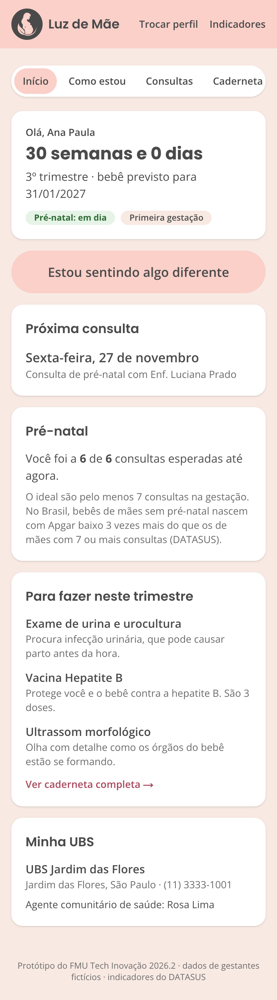
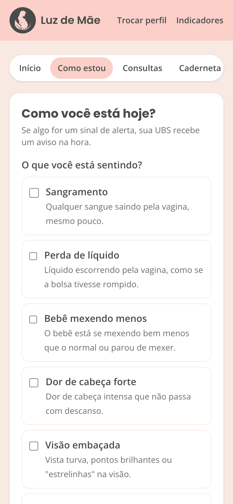
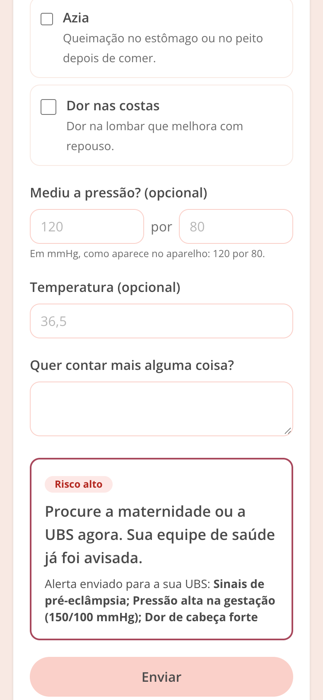
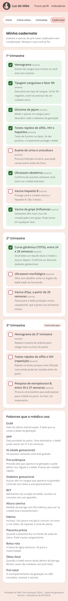
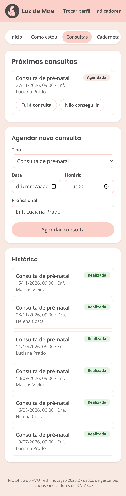
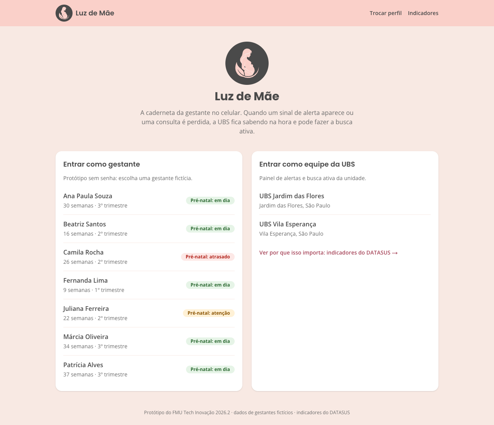
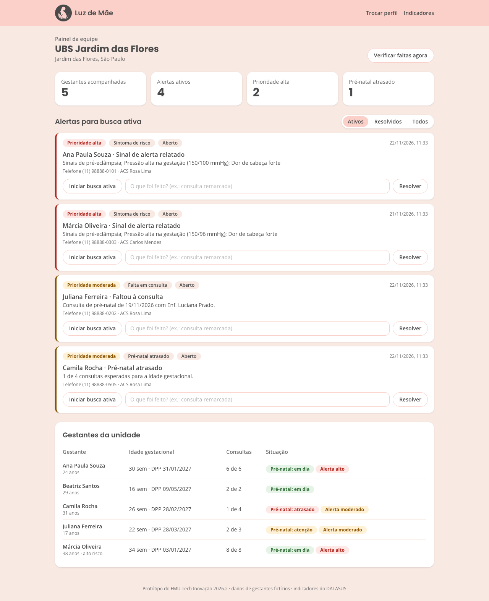
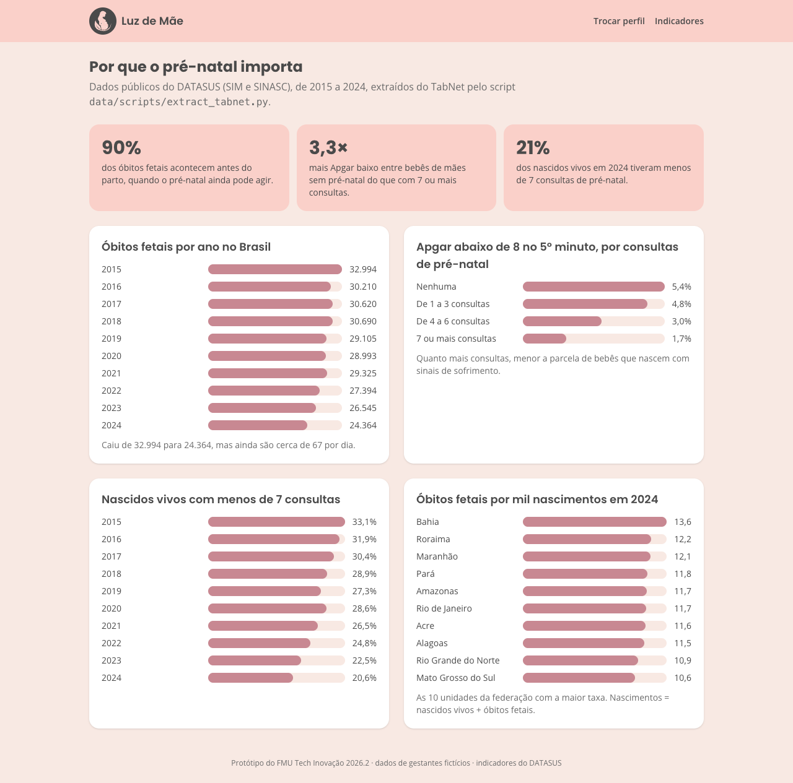

# Luz de Mãe: Cuidado que Protege Vidas

<p align="center">
  
</p>

Caderneta da gestante digital que avisa a Unidade Básica de Saúde (UBS) quando
a gestante relata um sinal de alerta ou falta a uma consulta, para que a equipe
faça a busca ativa antes que o quadro se agrave.

Projeto do **FMU Tech Inovação 1ª Edição (2026.2)**, alinhado ao ODS 3 da ONU
(Saúde e Bem-Estar).

| Entrega | Onde está |
| --- | --- |
| Checkpoint 1: proposta | seções [1](#1-o-problema) a [4](#4-pitch) |
| Checkpoint 2: protótipo funcional | seções [5](#5-evolução-desde-o-checkpoint-1) a [11](#11-estrutura-do-repositório) |
| Vídeo de demonstração | [`docs/demo.mp4`](docs/demo.mp4) |

---

## 1. O problema

A mortalidade fetal é uma tragédia silenciosa e, em muitos casos, evitável. Um
dos principais fatores que levam ao óbito fetal é a falta de acompanhamento
adequado e o abandono do pré-natal.

Muitas gestações de risco não são monitoradas de perto por causa da dificuldade
de comunicação entre o sistema de saúde e a paciente, ou porque a gestante não
entende a importância dos exames e dos sintomas de alerta.

**Público afetado:** gestantes, principalmente as que dependem do SUS e as mães
de primeira viagem. O projeto também apoia agentes comunitários de saúde (ACS) e
enfermeiros, que precisam acompanhar a adesão dessas mulheres ao pré-natal.

### O que os dados públicos mostram

Extraímos do DATASUS ([SIM](http://tabnet.datasus.gov.br/cgi/tabcgi.exe?sim/cnv/fet10uf.def)
e [SINASC](http://tabnet.datasus.gov.br/cgi/tabcgi.exe?sinasc/cnv/nvuf.def))
os dados de 2015 a 2024. O protótipo mostra esses números na tela
**Indicadores**:

- **90%** dos óbitos fetais acontecem **antes do parto**, quando o pré-natal ainda pode agir.
- Bebês de mães **sem pré-natal** nascem com Apgar baixo **3,3 vezes** mais do que os de mães com 7 ou mais consultas (5,4% contra 1,7%).
- **21%** dos nascidos vivos em 2024 tiveram **menos de 7 consultas** de pré-natal.
- Foram **24.364** óbitos fetais em 2024, cerca de 67 por dia.

## 2. A solução

O Luz de Mãe é uma caderneta da gestante digital e inteligente. Ele traduz
termos médicos para uma linguagem acolhedora, mostra os exames e vacinas de cada
trimestre e acompanha o bem-estar da mãe.

Se a gestante falta a uma consulta ou registra um sintoma de risco, como pressão
alta, um alerta chega à UBS da região dela. A equipe faz a busca ativa e registra
o que foi feito.

### Justificativa das escolhas técnicas

- **Next.js/React (front-end):** a gestante acessa pelo navegador do celular, sem baixar nada da loja e sem ocupar espaço no aparelho. As páginas chegam montadas pelo servidor e abrem rápido mesmo em conexão móvel lenta. Os mesmos componentes (cartão de consulta, selo de risco) aparecem em todas as telas.
- **Node.js com NestJS (back-end):** usa TypeScript, a mesma linguagem do front-end. As duas pontas compartilham tipos, regras de risco e validação pelo pacote `packages/shared`, o que evita divergência nos dados de saúde. O NestJS separa o código em módulos (gestantes, consultas, sintomas, alertas, UBS, indicadores). A verificação de faltas roda em segundo plano e não trava o uso do app.
- **SQLite (banco de desenvolvimento):** o banco é um único arquivo, sem servidor para instalar. Cada integrante roda o projeto completo na própria máquina em poucos minutos, e o modelo relacional já liga gestante, consultas, sintomas e alertas.

## 3. Identidade visual

**Paleta:**

| Cor | Hex | Uso |
| --- | --- | --- |
| Rosa Pastel | `#FAD0C9` | cor principal: acolhimento, cuidado maternal |
| Rosa Bebê | `#F8E9E3` | fundos, leveza e respiro |
| Cinza Escuro | `#4A4A4A` | texto, alta legibilidade sem o peso do preto |

**Tipografia:** Poppins nos títulos (arredondada e amigável) e Open Sans nos
textos (limpa e legível para gestantes de qualquer idade).

A logo mostra a silhueta de uma gestante abraçando o ventre, ladeada por formas
que lembram folhas: cuidado contínuo, vida em formação e acolhimento.

## 4. Pitch

*O Luz de Mãe é um aplicativo de acompanhamento humanizado que transforma o
pré-natal em uma jornada de acolhimento e segurança. Diferente de sistemas
médicos frios ou cadernetas de papel que acabam esquecidas, ele cria uma ponte
digital entre a gestante e o sistema de saúde. Ao traduzir orientações médicas
para uma linguagem simples e alertar a rede de apoio quando a paciente falta a
consultas, o Luz de Mãe atua na prevenção ativa, para que nenhuma mulher passe
por uma gestação de risco desamparada.*

---

## 5. Evolução desde o Checkpoint 1

No Checkpoint 1 o repositório tinha a proposta, a identidade visual e o
extrator de dados do DATASUS. No Checkpoint 2 a proposta virou um protótipo
funcional com a arquitetura prometida:

| Proposta do Checkpoint 1 | O que existe agora |
| --- | --- |
| Caderneta da gestante digital | Telas de início, consultas e caderneta com exames e vacinas por trimestre |
| Traduzir termos médicos | Explicação simples em cada exame e vacina, mais um glossário |
| Monitorar o bem-estar da mãe | Registro de sintomas, pressão e temperatura com classificação de risco |
| Alerta à UBS em sintoma de risco | Regra de risco cria o alerta na hora, com prioridade |
| Alerta à UBS em falta de consulta | Job agendado marca faltas e cria o alerta; a gestante também pode avisar |
| Apoio a ACS e enfermeiros | Painel da UBS com busca ativa, resolução e situação de cada gestante |
| Dados do SIM e SINASC | Tela de indicadores calculados a partir dos CSVs extraídos |
| Next.js + NestJS + SQLite | Monorepo com as três peças, testes e banco com migração |

Também entrou o que não estava na proposta: detecção de **pré-natal atrasado**
pelo calendário do Ministério da Saúde (consulta mensal até 28 semanas,
quinzenal até 36 e semanal depois).

**Retornos do Professor Mentor:** _(preencher com os retornos recebidos no
Checkpoint 1 e como cada um foi incorporado)_

## 6. Fluxo principal

```
1. Gestante ────▶ registra sintoma ou pressão em "Como estou"
2. API ─────────▶ classifica o risco (baixo, moderado, alto)
3. API ─────────▶ cria o alerta para a UBS da gestante
4. Painel UBS ──▶ mostra o alerta por prioridade
5. Equipe ──────▶ inicia a busca ativa e registra a resolução
```

Faltas seguem o mesmo caminho. A cada 10 minutos, e ao iniciar a API, um job
marca como falta toda consulta passada que ninguém confirmou e avisa a UBS.

**Regras de risco** (em `packages/shared/src/risk.ts`, com testes):

- **Alto:** pressão a partir de 140/90, sangramento, perda de líquido, bebê mexendo menos, contrações antes de 37 semanas, febre de 39 °C ou mais, sinais de pré-eclâmpsia.
- **Moderado:** dor de cabeça forte, visão embaçada, inchaço repentino, febre, ardência ao urinar.
- **Baixo:** enjoo, azia, dor nas costas. Não gera alerta; vira orientação para a próxima consulta.

As regras seguem os sinais de alerta da Caderneta da Gestante do Ministério da
Saúde. Elas decidem quando avisar a UBS e não substituem avaliação clínica.

## 7. Como executar

**Pré-requisitos:**

- [Node.js](https://nodejs.org) 22.12 ou mais recente (testado no 26)
- npm 10 ou mais recente (vem com o Node)
- Git

**Passo a passo:**

```bash
git clone https://github.com/FeKom/Luz-de-mae.git
cd Luz-de-mae
npm install
npm run dev
```

O `npm install` instala as três partes do monorepo e compila o pacote
compartilhado. O `npm run dev` sobe as duas aplicações juntas:

| Aplicação | Endereço |
| --- | --- |
| Web (Next.js) | http://localhost:3000 |
| API (NestJS) | http://localhost:3001/api |

Na primeira execução a API cria o arquivo `apps/api/luz-de-mae.sqlite`, aplica
as migrações e carrega os dados de demonstração. As datas são relativas ao dia
de hoje, então a demo funciona em qualquer data.

**Roteiro para testar o fluxo principal:**

1. Abra http://localhost:3000 e entre como **Ana Paula Souza**.
2. Toque em **Estou sentindo algo diferente**, marque "Dor de cabeça forte" e informe a pressão 150 por 100.
3. Envie: o app mostra "Risco alto" e confirma que a UBS foi avisada.
4. Clique em **Trocar perfil** e entre como **UBS Jardim das Flores**: o alerta está no topo.
5. Clique em **Iniciar busca ativa**, escreva o que foi feito e clique em **Resolver**.

**Outros comandos:**

| Comando | O que faz |
| --- | --- |
| `npm test` | testes unitários (regras e indicadores) e e2e do fluxo principal |
| `npm run typecheck` | checagem de tipos das três partes |
| `npm run lint` | lint da API (oxlint) e da web (ESLint) |
| `npm run db:reset` | apaga o banco; a API recria com os dados de demonstração |
| `npm run build && npm start` | build e execução em modo produção |

**Problemas comuns:**

- Porta ocupada: a web usa a 3000 e a API a 3001. Mude com `PORT=3101 npm run start:dev -w api` e `API_URL=http://localhost:3101/api npm run dev -w web`.
- Página "A API não respondeu": a API não subiu. Veja o terminal com o prefixo `[api]`.

**Atualizar os dados do DATASUS (opcional):** os CSVs já estão em `data/raw`.
Para baixar de novo, rode com Python 3.12 ou mais recente, sem dependências:

```bash
python3 data/scripts/extract_tabnet.py --first-year 2015 --last-year 2024
```

## 8. Prints do protótipo

| Gestante: início | Gestante: registro de sintoma | Gestante: alerta enviado |
| --- | --- | --- |
|  |  |  |

| Gestante: caderneta | Gestante: consultas | Escolha de perfil |
| --- | --- | --- |
|  |  |  |

**Painel da UBS:** alertas por prioridade, busca ativa e situação de cada gestante.



**Indicadores do DATASUS:**



## 9. Vídeo de demonstração

[`docs/demo.mp4`](docs/demo.mp4) (55 s): a gestante registra pressão alta com
dor de cabeça e visão embaçada, a UBS recebe o alerta, inicia a busca ativa,
resolve e consulta os indicadores.

## 10. Tecnologias utilizadas

| Camada | Tecnologia | Para quê |
| --- | --- | --- |
| Front-end | Next.js 16, React 19, Tailwind CSS 4 | telas, Server Components e Server Actions |
| Back-end | Node.js, NestJS 12 | API REST em módulos, job agendado de faltas |
| Banco | SQLite (better-sqlite3), Drizzle ORM | schema tipado e migrações |
| Validação | Zod, compartilhado entre web e API | mesmas regras nas duas pontas |
| Testes | Vitest, Supertest | regras de risco, indicadores e fluxo e2e |
| Qualidade | TypeScript strict, oxlint, ESLint | tipos e lint |
| Dados | Python 3.12, DATASUS TabNet | extração dos CSVs do SIM e do SINASC |

## 11. Estrutura do repositório

```
Luz-de-mae/
├── apps/
│   ├── api/                  NestJS + Drizzle + SQLite
│   │   ├── drizzle/          migrações SQL
│   │   ├── src/alerts/       alertas, regras e job de busca ativa
│   │   ├── src/appointments/ consultas
│   │   ├── src/database/     schema e dados de demonstração
│   │   ├── src/indicators/   cálculo dos indicadores do DATASUS
│   │   ├── src/patients/     gestantes e caderneta
│   │   └── test/             teste e2e do fluxo principal
│   └── web/                  Next.js
│       └── src/app/          rotas /gestante, /ubs, /indicadores
├── packages/shared/          tipos, schemas Zod e regras de risco
├── data/
│   ├── raw/                  CSVs extraídos do DATASUS
│   └── scripts/              extrator do TabNet
└── docs/                     prints e vídeo
```

**Limitações do protótipo:** não há login (o perfil é escolhido na tela
inicial), os dados de gestantes são fictícios e o alerta aparece no painel da
UBS, sem SMS ou WhatsApp.

## 12. Equipe

- Faruc Matheus de Medeiros Martins, RA 20261017031
- Felipe Komninakis, RA 2026109201
- Weverton da Silva Luna, RA 2026110799
