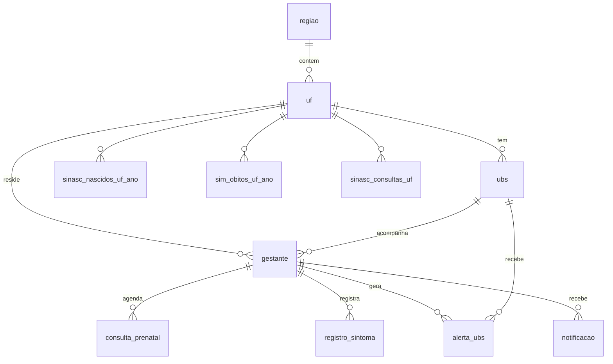

# Luz de Mãe — Backend (Checkpoint 2)

API **Node.js + Express** com banco **SQLite**, alimentada com os dados públicos do **DATASUS (SIM e SINASC)** que estão em `data/raw/`.

- **Dados reais (DATASUS):** 18 CSVs importados para tabelas tipadas, com conferência automática dos totais.
- **Dados mockados (app):** UBS, gestantes fictícias, consultas e orientações (`npm run db:seed`).
- **Regras de negócio funcionando:** sintoma de risco → alerta na UBS; consulta faltada → busca ativa; tradutor de termos médicos por trimestre.

## Como executar

**Pré-requisito:** Node.js **22.13 ou superior** (usa o SQLite nativo do Node, sem compilar nada).

```bash
cd backend
npm install        # instala express e cors
npm run setup      # cria o banco, importa data/raw/*.csv e carrega os dados de demonstração
npm start          # API em http://localhost:3000/api/health
npm test           # 14 testes de integração (importação, regras de negócio e API)
```

Scripts individuais: `db:reset` (recria o banco), `db:import` (só DATASUS), `db:seed` (só dados do app). A importação é idempotente.
Variáveis opcionais: `PORT`, `DB_PATH`, `RAW_DIR`.

## Banco de dados (SQLite)

Schema completo em [`src/db/schema.sql`](src/db/schema.sql).



| Grupo | Tabelas | Origem |
|---|---|---|
| Dimensões | `regiao`, `uf` | Fixas (IBGE) |
| SINASC (nascidos vivos) | `sinasc_nascidos_uf_ano`, `sinasc_consultas_uf`, `sinasc_consultas_ano`, `sinasc_adequacao_uf`, `sinasc_cruzamento` | CSV `nascidos_*` |
| SIM (óbitos fetais) | `sim_obitos_uf_ano`, `sim_causa_ano`, `sim_causa_regiao`, `sim_cid_ano`, `sim_perfil_ano`, `sim_investigacao_uf`, `sim_relacao_parto_uf` | CSV `obitos_fetais_*` |
| Controle | `importacao_log` | Gerada na importação |
| Aplicativo | `ubs`, `gestante`, `consulta_prenatal`, `registro_sintoma`, `alerta_ubs`, `orientacao`, `notificacao` | Mock (seed) + uso da API |

### Como os CSVs viram tabelas
Todos os CSVs estão no formato longo `linha,coluna,valor`. O importador (`src/db/importRaw.js`):
1. converte cada arquivo para uma tabela com colunas nomeadas (ex.: `uf_codigo, ano, qtd`);
2. **não grava as linhas/colunas "Total"** (evita dupla contagem) e as usa para **conferir** a soma, registrando o resultado em `importacao_log` (`GET /api/estatisticas/fontes`);
3. separa a hierarquia de causas em `nivel = 'capitulo'` / `'grupo'` (no CSV os subitens começam com `". "`);
4. extrai o código CID (`P95`, `Q90`, …) da descrição e normaliza rótulos (`"1000 a 1499 g"` → `"1000 a 1499g"`).

**Observação:** `obitos_fetais_relacao_parto_uf.csv` soma 290.239 (1 a menos que os demais, 290.240). É assim no arquivo original; o total do próprio CSV confere com ele.

## Endpoints principais

**Estatísticas DATASUS** (`/api/estatisticas`)

| Rota | O que devolve |
|---|---|
| `GET /resumo` | Nascidos, óbitos fetais, taxa por mil, % sem pré-natal, % com 7+ consultas |
| `GET /serie-anual` | Evolução 2015–2024 |
| `GET /por-uf?ano=2024` | Ranking de UFs por taxa de mortalidade fetal |
| `GET /uf/SP` (ou `/uf/35`) | Panorama da UF: consultas, adequação, investigação, momento do óbito |
| `GET /prenatal/evolucao` | Nº de consultas por ano |
| `GET /prenatal/desfecho/peso` (`duracao_gestacao`, `apgar5`) | **Resultado do bebê × nº de consultas de pré-natal** |
| `GET /causas`, `/causas/regiao`, `/cid`, `/perfil/:dimensao` | Causas, CID, perfil da mãe/óbito |
| `GET /fontes` | Log de importação e conferência de totais |

**Aplicativo** (`/api`)

| Rota | Função |
|---|---|
| `POST /gestantes`, `GET /gestantes/:id` | Cadastro; devolve semanas, trimestre e DPP calculados pela DUM |
| `GET /gestantes/:id/orientacoes` | Tradutor de termos médicos, exames e vacinas do trimestre atual |
| `GET /gestantes/:id/contexto-regional` | Dados do DATASUS da UF da gestante |
| `POST /consultas`, `PATCH /consultas/:id` | Agenda; `{"status":"faltou"}` dispara a busca ativa |
| `POST /sintomas` | Registra pressão/sintomas, classifica o risco e alerta a UBS se médio/alto |
| `GET /alertas?ubs_id=1&status=aberto`, `PATCH /alertas/:id` | Painel da UBS |
| `POST /jobs/verificar-faltas` | Rotina diária: consultas vencidas viram "faltou" |

### Exemplo do fluxo principal
```bash
# 1) gestante registra pressão alta e sintomas
curl -X POST localhost:3000/api/sintomas -H 'Content-Type: application/json' \
  -d '{"gestante_id":1,"pa_sistolica":150,"pa_diastolica":98,"sintomas":["dor_de_cabeca_intensa","visao_turva"]}'
# 2) a UBS vê o alerta prioritário
curl 'localhost:3000/api/alertas?ubs_id=1&status=aberto'
# 3) a equipe atende e resolve
curl -X PATCH localhost:3000/api/alertas/1 -H 'Content-Type: application/json' -d '{"status":"resolvido"}'
```

## Decisões técnicas e limitações
- **SQLite via `node:sqlite`** (embutido no Node 22): sem dependência nativa, funciona igual em qualquer máquina. É o módulo marcado como *experimental* pelo Node; o aviso é silenciado nos scripts.
- **Taxa de mortalidade fetal** = óbitos fetais ÷ (nascidos vivos + óbitos fetais) × 1000.
- **Classificação de risco** (`src/services/risco.js`) é uma regra de triagem **demonstrativa** (PA ≥ 140/90 = alto; 130/85 = médio; lista de sinais de alerta). Não substitui avaliação profissional e deve ser validada pela equipe de saúde.
- **Orientações** (`src/db/seed.js`) são conteúdo simplificado e demonstrativo; validar com a Caderneta da Gestante do Ministério da Saúde.
- **Firebase (FCM):** as notificações são gravadas na tabela `notificacao` e logadas; o envio real está isolado em `src/services/notificacoes.js` (função `enviarFcm`), pronto para receber as credenciais.
- **Sem autenticação** nesta fase (protótipo). Para produção: login, perfis (gestante/UBS) e LGPD para dados de saúde.
